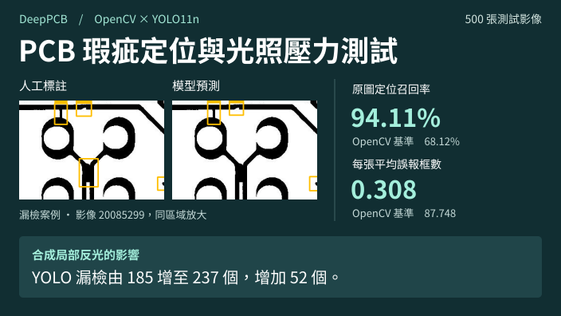

# PCB 六類瑕疵檢測與光照壓力測試

以 DeepPCB 比較 OpenCV 模板差分與 YOLO11n 單張影像偵測。使用 800 張影像訓練、200 張驗證，鎖定門檻後在官方 500 張測試圖評估。

| 原圖，定位 IoU > 0.50 | OpenCV | YOLO11n |
|---|---:|---:|
| 定位召回率 | 68.12% | 94.11% |
| 每張誤報框數 | 87.748 | 0.308 |
| 漏檢瑕疵數 | 1,001 | 185 |

YOLO11n 六類 mAP50–95 為 75.49%。同一批測試圖加入合成局部反光後，模型漏檢數由 185 增至 237。原始測試集全數含瑕疵，估算良品誤剔率仍需真良品樣本。

## 重現結果

1. 在 Google Colab 上傳 [完整筆記本](notebooks/DeepPCB_Full_Inspection_Colab.ipynb)。第 0 節可直接使用 CPU 重算先前結果。
2. 要重跑影像評估，選擇 GPU，將 [既有模型成果包](checkpoints/pcb_model_results.zip) 上傳至 Colab 的 /content 目錄，保留 TRAIN_NEW=False、RUN_STRESS=True，依序執行。
3. 資料下載程式固定 DeepPCB 的版本與切分；部署到其他板型或材質前，應另外取得對應的測試樣本。

## 實驗報告

- [驗證集選定的門檻](reports/locked_thresholds.json)
- [檢驗與誤報統計](reports/inspection_report.csv)
- [逐類 AP](reports/per_class_ap.csv)
- [合成光照測試](reports/stress_comparison.csv)

[資料集與標註來源：DeepPCB](https://github.com/tangsanli5201/DeepPCB)
